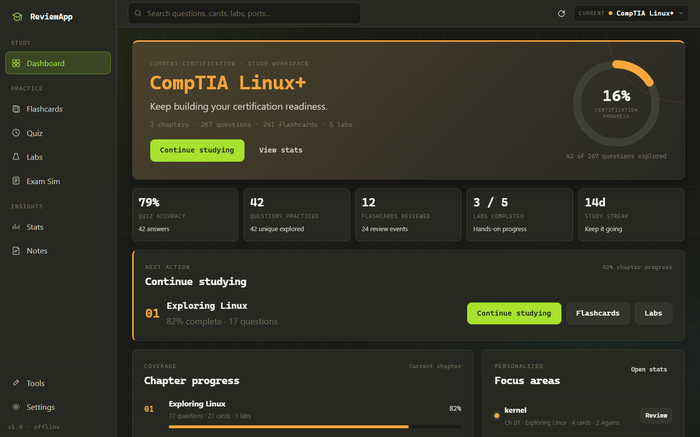
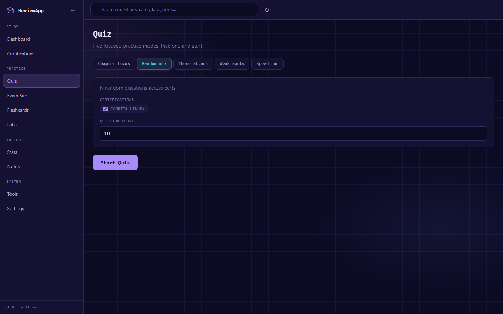
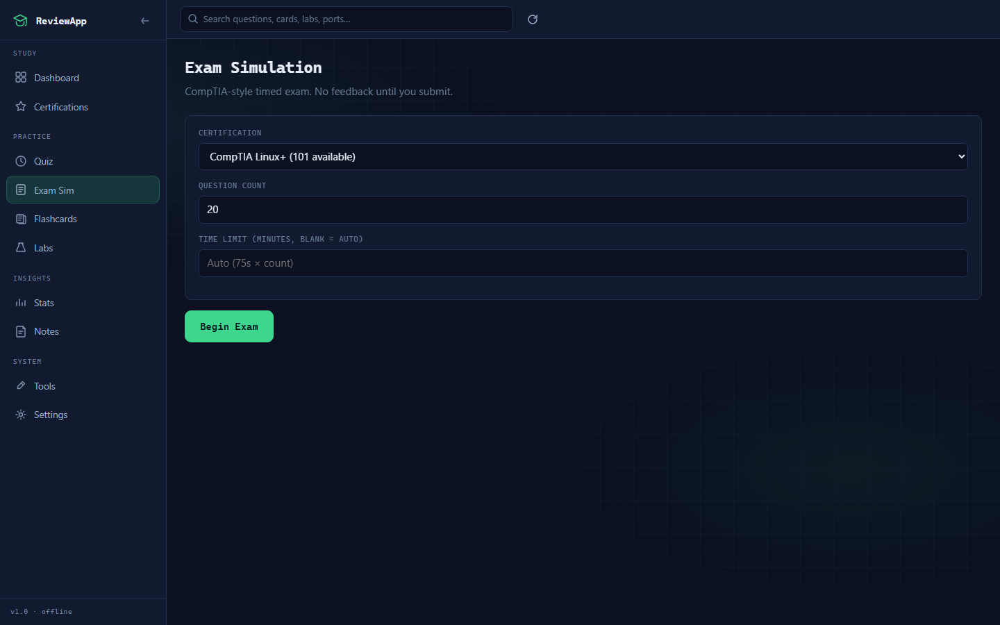
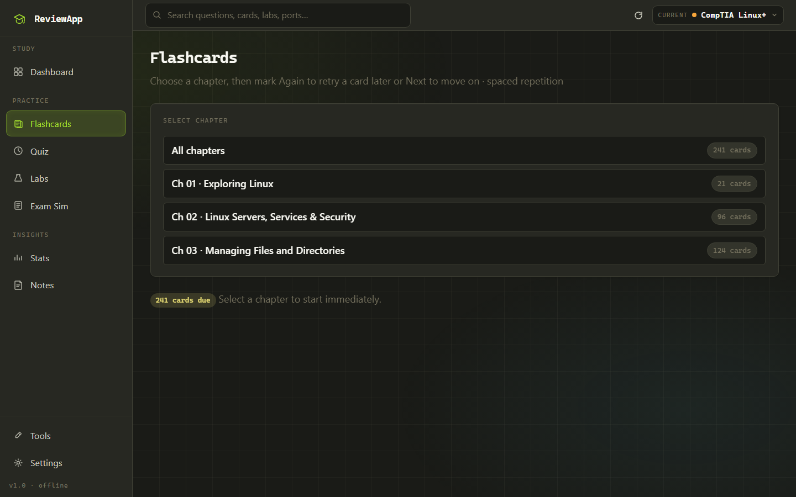
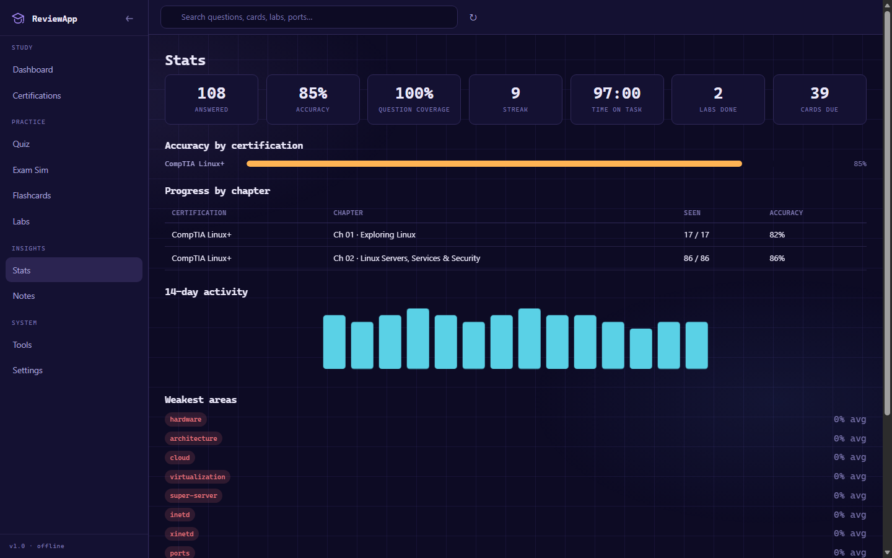

# ReviewApp

**An offline study & review hub for certification learning.**

ReviewApp is a vanilla HTML/CSS/JavaScript study platform that runs entirely
locally — no account, build step, framework, CDN, or network connection. Open
`ReviewApp.html`, pick a certification, and start studying content loaded from
the local `certifications/` directory.

It follows a **one-certification-at-a-time** model. Choose the active
certification from the **Current certification** picker in the top-right of the
top bar, and every certification-scoped view stays inside that certification.
Tools, Settings, and Global Search stay available independently, and all study
data is kept privately in the browser's IndexedDB database.

## Table of contents

- [Screenshots](#screenshots)
- [Quick start](#quick-start)
- [Main features](#main-features)
- [Content formatting](#content-formatting)
- [How it works](#how-it-works)
- [Adding certifications & study content](#adding-certifications--study-content)
- [Documentation](#documentation)
- [Privacy / data](#privacy--data)
- [Troubleshooting](#troubleshooting)
- [Development & tests](#development--tests)
- [License / intent](#license--intent)

---

## Screenshots

| Dashboard | Quiz |
|---|---|
|  |  |
| Certification-scoped progress, recommendations, activity, and chapter actions. | Five practice modes with chapter and certification context. |

| Exam Simulation | Flashcards |
|---|---|
|  |  |
| Timed exam configuration with question palette and flag-for-review. | Card review with the Again / Next workflow and spaced repetition. |

| Stats |
|---|
|  |
| Certification-scoped accuracy, coverage, activity, and weak areas. |

---

## Quick start

1. Open the project folder.
2. Double-click **`ReviewApp.html`**.
3. Use Chrome, Edge, Firefox, or Safari.

All progress lives in the browser's local IndexedDB database. Existing ReviewApp profiles are migrated from legacy localStorage automatically on first launch; the legacy data is not deleted automatically.

> **Tip:** If content does not load in a strict `file://` environment, open
> **Settings → Deep-scan folder…** and select the `certifications` directory.
> Any simple static HTTP server also works.

---

## Main features

- **Dashboard** — certification-scoped stats, recommendations, 14-day activity, and an ordered **Next action** for each chapter: **Flashcards → Quiz**. It advances to the next chapter when the current chapter is complete and resumes active sessions when available.
- **Quiz** — Chapter Focus, Random Mix, Theme Attack, Weak Spots, and Speed Run modes, with keyboard shortcuts (`1-5` to select options, Enter/Space to submit and advance). Each question shows its type (MCQ, multi-select, true/false, fill-in, matching) in a chip beside the prompt. Questions answered wrong are shown again at the end (practice-only, so they never double-count toward your score or stats), and feedback color-codes multi-select choices — green for correct picks, amber for missed answers, red for wrong ones.
- **Exam Simulation** — timed exam with question palette, flag-for-review, pass threshold, and keyboard answer selection.
- **Flashcards** — flip cards with Again / Next, Shuffle, a retry queue, and saved-session resume or cancel.
- **Notes** — one complete note per chapter with all source sections inside it. Notes render Markdown tables and fenced code blocks natively. A floating **Back to top** button appears as you scroll down for quick navigation.
- **Stats** — accuracy, coverage, streaks, activity, weak areas, and exportable reports.
- **Tools** — subnet calculator, number converter, common ports, a Linux command reference, and a permissions calculator with a live symbolic/octal/chmod readout, common-mode presets, and special-bit toggles.
- **Permissions Practice** — a procedurally generated exercise engine (no question bank) built into the Permissions tool: mode conversions, symbolic `chmod` deltas, permission-matrix configuration, special bits, and file/directory scenarios. Includes difficulty levels, configurable exercise types, session stats, structured per-class feedback, and keyboard shortcuts (`1-4` to pick options, Enter to submit).
- **Search** — global search across notes, flashcards, questions, ports, and commands. Press **`/`** anywhere to focus the search bar. Choosing a note result scrolls directly to the first matching text occurrence inside the chapter.
- **Settings** — themes, text size, animations, exam threshold, and Backup & Data.

## Content formatting

Study content supports safe inline Markdown across the app. Wrap commands,
paths, flags, or other short code snippets in backticks:

```text
Which `ls` option lists hidden files?
```

Inline code is rendered consistently in question titles, answer options,
explanations, matching items, flashcards, notes, search results, and
reference content. **Tables** (GFM pipe syntax) render with themed header and
cell styling. User-provided HTML is escaped before rendering, so content
formatting cannot inject markup into the app. Fenced code blocks and literal
command output remain preserved as code blocks.

---

## How it works

- Study one certification at a time; switch with the **Current certification** picker.
- Certification-scoped views (Dashboard, Quiz, Exam Sim, Flashcards, Notes, Stats) always follow the active certification.
- The Dashboard chooses the first unfinished phase in chapter order: **Flashcards**, then **Quiz**. After all available phases are complete, it moves to the next chapter; missing content types are skipped.
- Active flashcard or quiz sessions take priority in **Next action** so you can resume the work already in progress.
- User data is stored locally in IndexedDB — no data is sent anywhere. Certification content remains file-based under `certifications/`.
- Existing localStorage data is migrated non-destructively on first launch.
- Backup & Data creates a single dated ZIP for progress, study material, or both.

---

## Adding certifications & study content

Content is plain JavaScript that self-registers through
`certifications/_manifest.js`. Add a certification's metadata and file paths
there, then reload. See **[Adding Certifications & Content](./docs/CONTENT.md)**,
and use the full schemas in
**[CONTENT_FORMAT.md](./docs/CONTENT_FORMAT.md)** when writing content.

---

## Documentation

**Guides**

- **[Documentation index](./docs/README.md)** — all guides at a glance
- **[Backups & Data](./docs/BACKUPS.md)** — exporting and importing ZIP backups
- **[Persistence Architecture](./docs/PERSISTENCE.md)** — IndexedDB storage, migration, and recovery
- **[Adding Certifications & Content](./docs/CONTENT.md)** — how to add study material
- **[Study Flows](./docs/STUDY-FLOWS.md)** — how the app is meant to be used
- **[Content Format](./docs/CONTENT_FORMAT.md)** — full question/flashcard/note schemas

**AI prompts**

- **[Material Generator prompts](./docs/prompts/material-generator.md)** — ready-made prompts that turn your notes into complete content files (flashcards, questions, notes)
- **[Book/PDF → Obsidian Notes](./docs/prompts/linux-to-obsidian.md)** — a copy-and-paste master prompt that converts a book or PDF into polished, structured Obsidian study notes

---

## Privacy / data

ReviewApp is fully offline. Your progress, answers, notes, and settings never
leave your device, and backups stay local ZIP files.

---

## Troubleshooting

- **Blank content:** use the reload button or **Settings → Deep-scan folder…**.
- **New certification not appearing:** check `_manifest.js` and reload.
- **Clicks not working:** hard-refresh (`Ctrl+F5`) or try a different browser.

---

## Development & tests

ReviewApp has no build step — the app is plain HTML/CSS/JS and content files
self-register. The test suite is plain Node scripts with no dependencies; run
each file directly:

```text
node tests/answer-validation.test.js
node tests/backup-import.test.js
node tests/flashcards.test.js
node tests/markdown.test.js
node tests/perms-exercise.test.js
node tests/question-quality.test.js
node tests/quiz-retry.test.js
```

---

## License / intent

Built as a personal offline study tool for certification learning. Ship your
own content, keep your data local, and study without distraction.

Created by **mfundora19**.
